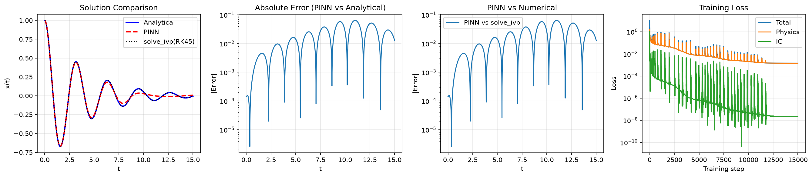
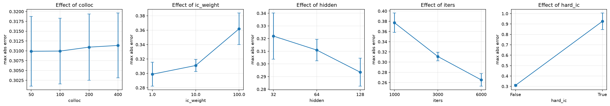

# Physics-Informed Neural Network (PINN) for the Damped Harmonic Oscillator

A physics-informed neural network that solves the damped harmonic oscillator ODE **without any labeled data** — the network learns the solution purely from the equations of motion and initial conditions.

## The Physics

A damped harmonic oscillator (mass on a spring with friction) obeys:

```
x''(t) + 2·γ·x'(t) + ω₀²·x(t) = 0
x(0)  = 1        (initial displacement)
x'(0) = 0        (initial velocity)
```

With parameters γ = 0.25 (damping) and ω₀ = 2.0 (natural frequency), the system is **underdamped** and oscillates with an amplitude that decays exponentially. The exact analytical solution is:

```
x(t) = e^(−γt) · [ A·cos(ω_d·t) + B·sin(ω_d·t) ]
      where ω_d = √(ω₀² − γ²)
```

## The Approach

Instead of numerically stepping the ODE forward in time (like Euler or Runge-Kutta), a PINN bakes the physics directly into the loss function:

| Loss term | What it enforces |
|-----------|------------------|
| **Physics residual** | The network output `x(t)` must satisfy the ODE at collocation points across the time domain. Autograd computes `x''` and `x'` from the network. |
| **Initial condition** | `x(0) = 1` and `x'(0) = 0` are enforced as *soft* constraints (weighted more heavily than the residual). |

Total loss = `physics_residual² + 10·(IC terms)`. Training minimizes this loss with Adam + cosine annealing.

The key idea: the network is a surrogate for the solution function `x(t)`, and automatic differentiation (autograd) lets us impose the differential equation directly — no discretization grid required.

### Two ways to impose the initial conditions

The code supports both approaches (`--hard-ic` toggles between them), and they are compared in `experiments.py`:

- **Soft (default):** add `x(0)=1`, `x'(0)=0` as penalty terms in the loss.
- **Hard:** reparameterize the output as `x(t) = x0 + v0·t + t²·N(t)`, which satisfies the ICs *exactly* for any network `N(t)`.

Hard enforcement makes the IC error exactly zero, but it converged **substantially worse** on this problem (see Experiments below). The reason is the `t²` scaling: over a solution that decays to ~2% of its initial value, the network must output ever-smaller amplitudes across a wide dynamic range, which is numerically harder than a soft penalty. It is a concrete example of how solution parameterization affects PINN training.

## Results

Comparison of the trained PINN against the exact analytical solution (default `pinn.py --save` run, seed 0):

- **Max absolute error**: `6.4e-2` (over t ∈ [0, 15], evaluated on 2000 points)
- **Mean absolute error**: `2.0e-2`
- **Initial-condition errors**: `|x(0)−1| ≈ 1.5e-4`, `|x'(0)−0| ≈ 1e-6`

The network captures both the exponential decay envelope and the damped oscillations across the full time domain.



*(Plots: solution comparison including a numerical-solver overlay, absolute error, PINN-vs-numerical error, and training loss.) Generate them with `python pinn.py --save`.*

## Comparison with numerical solvers

The PINN is benchmarked against two independent numerical solutions of the same ODE:

- A hand-written **RK4** integrator (`rk4_solution`)
- SciPy's adaptive **`solve_ivp`** (RK45), tight tolerances `rtol=1e-9, atol=1e-12`

Both reproduce the analytical solution to **~1e-8 (RK4)** and **~1e-10 (solve_ivp)**, confirming they are correct baselines. The PINN's error (~1e-2) is several orders of magnitude larger, because it approximates the *whole solution with one smooth function* rather than integrating step-by-step. The trade-off is that once trained, the PINN is a closed-form, differentiable surrogate evaluable anywhere in the domain — useful when you need `x(t)` inside a larger differentiable pipeline.

## Experiments

`experiments.py` varies one design factor at a time around a base configuration, averaged over **3 random seeds** (so a single lucky run cannot drive the conclusion). Base: 64-wide / 4-layer net, 200 collocation points, 3000 iterations, IC weight 10. Full results in `results/experiments.csv`.



| Factor | Values tried | Max-error range | Observation |
|--------|--------------|-----------------|-------------|
| Collocation points | 50 → 400 | 0.30 – 0.32 | **Saturated** — adding points beyond 50 does not help at this iteration budget |
| Training iterations | 1000 → 6000 | 0.35 – 0.25 | **Monotone improvement**, with diminishing returns |
| IC loss weight | 1 / 10 / 100 | 0.28 / 0.30 / 0.35 | Trade-off: weight 1 gives large IC error (~3e-2), weight 100 gives tiny IC error (~5e-4) but a worse interior fit |
| Network width | 32 / 64 / 128 | 0.28 – 0.34 | Slight benefit from the widest net; weak effect |
| Hard vs soft ICs | False / True | 0.31 vs **0.83 – 1.03** | Hard enforcement is exact in the ICs but clearly **worse** overall |

Seed-to-seed spread is small (~0.02 in max error), so these trends are stable.

## Benchmarking: GPU vs CPU

Run `python pinn.py --benchmark` to time identical training loops on CPU versus GPU (if a CUDA GPU is available) and report the speedup.

## Getting Started

```bash
# 1. Clone and enter the project
git clone https://github.com/lakshchatt04-spec/pinn-damped-oscillator.git
cd pinn-damped-oscillator

# 2. Create a virtual environment
python -m venv .venv

#    Activate it — choose the line for your shell:
.venv\Scripts\Activate.ps1        # Windows PowerShell
.venv\Scripts\activate.bat        # Windows cmd.exe
source .venv/bin/activate         # macOS / Linux

# 3. Install dependencies
pip install -r requirements.txt

# 4. Train, evaluate against the analytical and numerical solutions, save plots
python pinn.py --save

# 5. (Optional) run the parameter sweep
python experiments.py --seeds 3

# 6. (Optional) benchmark CPU vs GPU
python pinn.py --benchmark
```

Tested with PyTorch 2.x and Python 3.10+ (CPU build). No GPU is required; the code uses CUDA automatically if available.

### Useful flags for `pinn.py`

| Flag | Default | Meaning |
|------|---------|---------|
| `--iters` | 15000 | Training iterations |
| `--colloc` | 400 | Number of collocation points |
| `--hidden` | 128 | Hidden width |
| `--ic-weight` | 10.0 | Weight on the initial-condition loss |
| `--hard-ic` | off | Hard-enforce ICs instead of soft penalty |
| `--seed` | none | Random seed for reproducibility |
| `--n-eval` | 2000 | Evaluation grid size |
| `--save` | off | Save model, predictions and plots |
| `--benchmark` | off | Run the CPU/GPU timing comparison |

## Project Layout

```
pinn-damped-oscillator/
├── pinn.py            # Model, physics/IC losses, training, evaluation, numerical solvers
├── experiments.py     # Factor sweep with multiple seeds -> results/experiments.*
├── requirements.txt   # torch, numpy, matplotlib, scipy
├── README.md
└── results/           # model.pt, predictions.npz, results.png, experiments.*
```

## Notes on the error metric

- "Absolute error" = `|x_PINN(t) − x_analytical(t)|`, evaluated on a dense grid (2000 points by default) to avoid reporting a sampling artifact.
- Initial-condition errors are reported **separately** and computed **exactly via autograd** at `t=0` (not by finite differences on the grid): `|x(0)−1|` and `|x'(0)−0|`.

## Why this project is useful

This project combines neural networks with a physical system whose behavior can be calculated analytically. By training a physics-informed neural network (PINN) to solve the damped harmonic oscillator, I can investigate how the choice of loss function, training parameters, and differential-equation constraints affects the accuracy of the predicted solution.

Comparing the network's predictions with the analytical solution provides a direct way to measure its accuracy and understand where the approach succeeds or struggles.

## Next Steps / Ideas

- Try a harder equation: the **nonlinear** pendulum `θ'' + (g/L)·sin(θ) = 0` (no closed-form solution — a true test).
- Investigate the error growth late in the domain (phase drift as the amplitude decays) and whether adaptive or residual-based collocation sampling fixes it.
- Explore better IC handling that avoids the large-dynamic-range problem of the hard ansatz.
